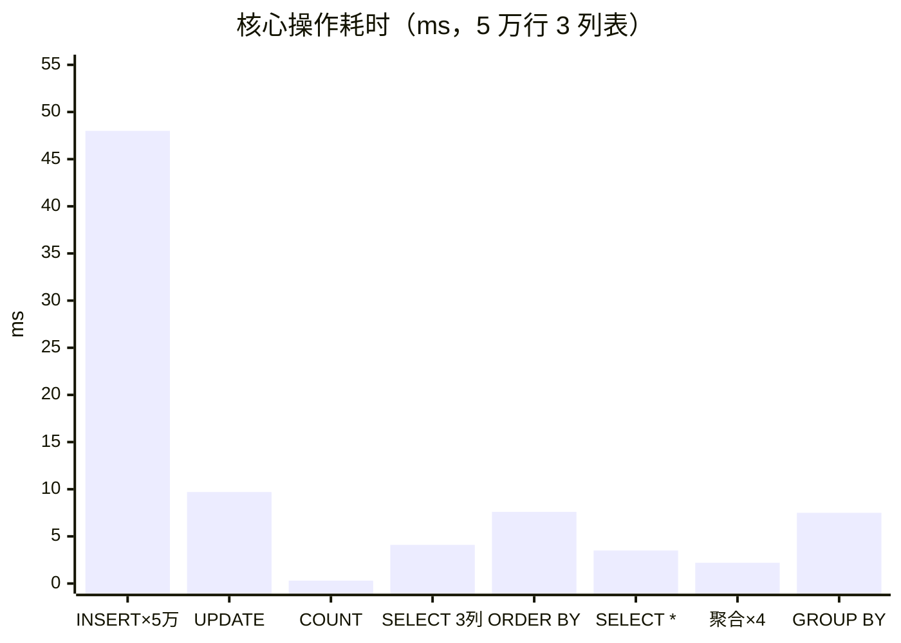
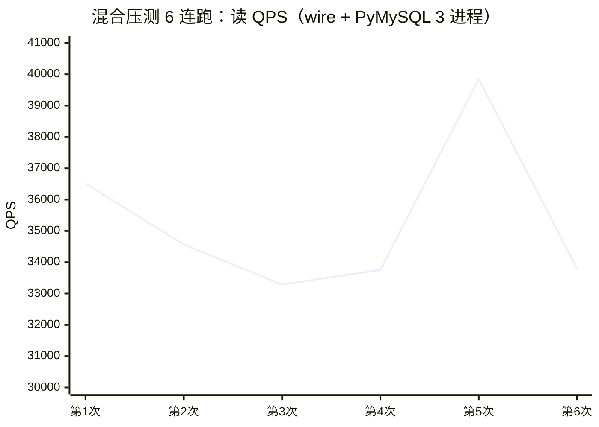
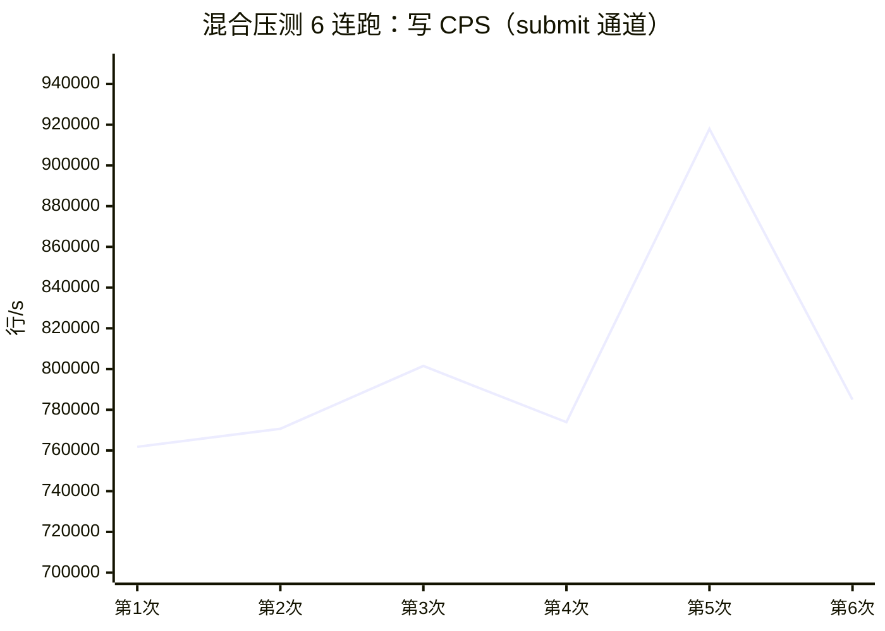
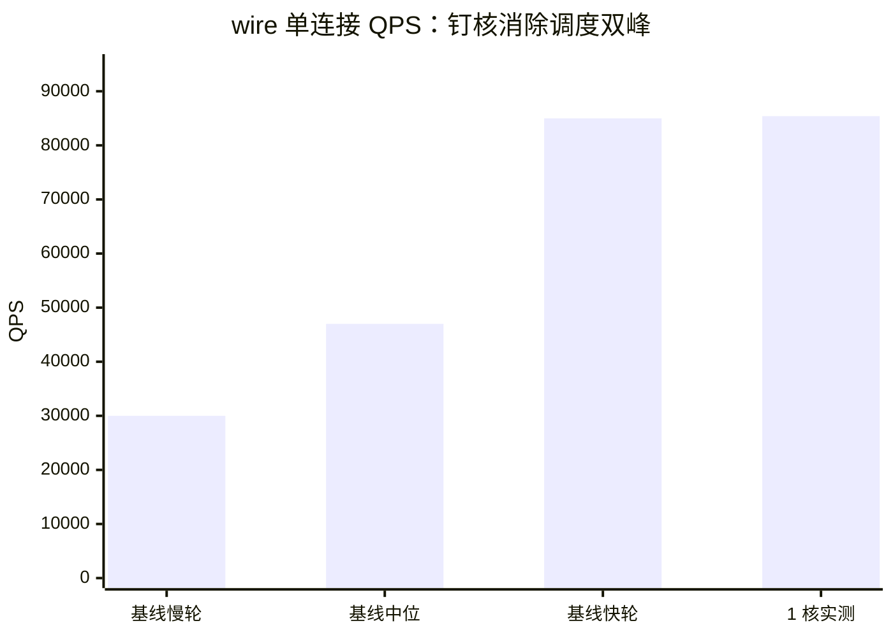
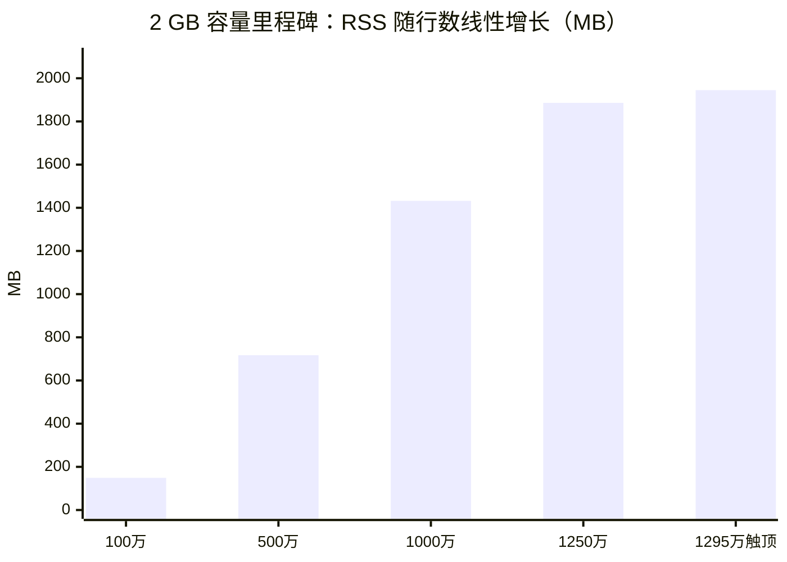
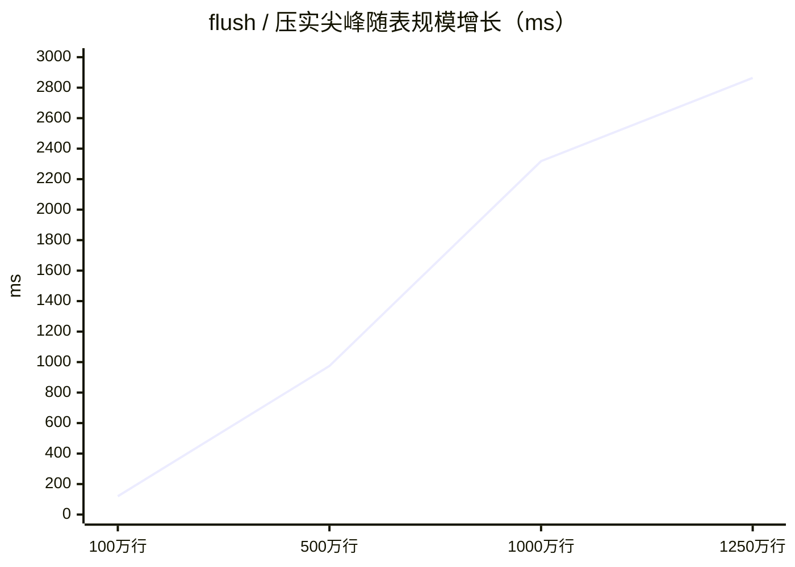
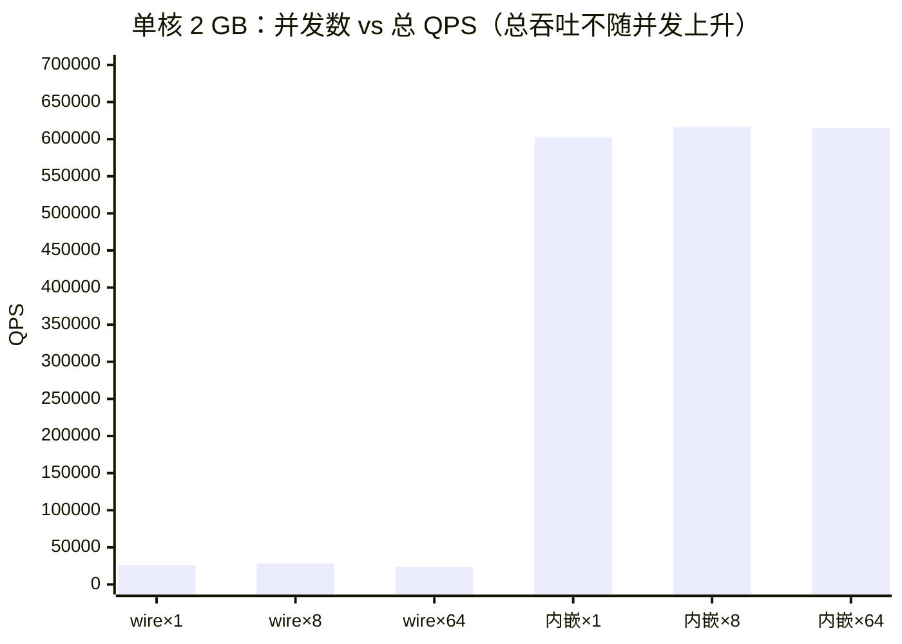
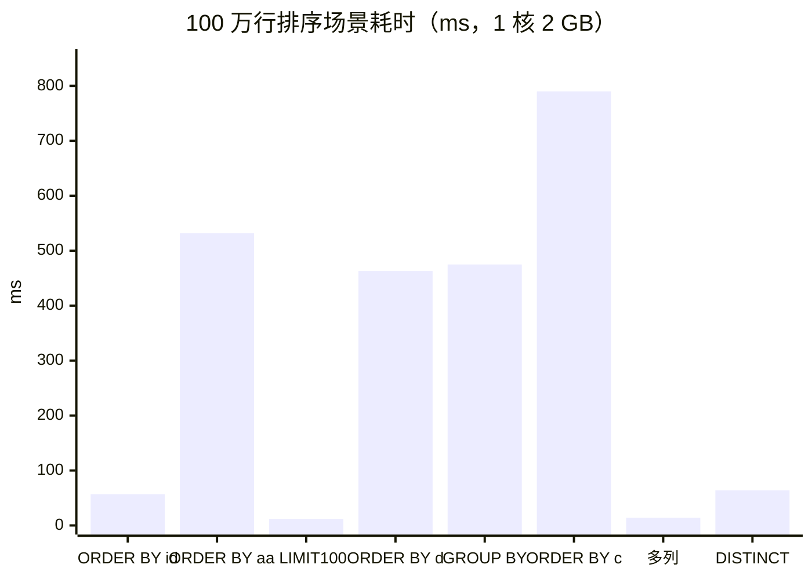

# NLSQL — 基于 MySQL 语义的嵌入式离线 SQL 引擎（NetLeaf 扩展）

NLSQL 是为 [NetLeaf](https://github.com/508364/netleaf) 制作的 C 语言扩展：一个纯本地、完全离线的嵌入式 SQL 引擎。它实现 MySQL 方言的常用子集并沿用 MySQL 的错误码与 SQLSTATE，采用异步架构；默认不启动服务端，需要时可用 `nlsql_wire_start()` 显式开启 MySQL 传输协议，且只绑定 127.0.0.1。零第三方依赖（仅 pthread + libm），只使用通用 CPU 指令，无 SIMD、无平台特有指令。

词法/语法分析、执行引擎、表达式求值、存储与主键哈希索引、WAL 与崩溃恢复、MySQL 传输协议及 `mysql_native_password` 认证，全部由 C11 手写实现，未引用、未修改、未链接任何 MySQL 官方源码。“MySQL 兼容”指语义与格式对齐（同一条 SQL 行为一致、错误码 / SQLSTATE / 协议包格式一致），不是代码复用。

**目录**：[来源与定位](#来源与定位) · [与其他数据库对比](#与其他-sql-数据库的对比) · [特性](#特性) · [构建与测试](#构建与测试) · [使用与项目结构](#使用与项目结构) · [性能实测](#性能实测) · [写入与持久化](#写入与持久化) · [压力测试与稳定性](#压力测试与稳定性) · [受限资源极限实测](#受限资源极限实测) · [结论](#结论) · [计划任务](#计划任务)

## 来源与定位

NLSQL 按 MySQL 语义独立重写，纯 C 自研，不 fork、不 vendor、不链接 MySQL 官方代码，目标是把 MySQL 的常用能力压缩进一个百 KB 级的嵌入式库。

- **实现来源**：全部逻辑为本项目原创 C11 代码，零第三方依赖；MySQL 兼容性由“对齐语义 / 错误码 / 协议格式”的测试矩阵锁定
- **保留**：MySQL 方言的常用语法（DML/DDL/聚合/子句）、MySQL 错误码与 SQLSTATE（1062/1049/1146/1064…）、`mysql_native_password` 认证的传输协议子集（真实 PyMySQL 驱动可直连）、`AUTO_INCREMENT`/`PRIMARY KEY` 等 MySQL 常见列特性
- **裁掉**：服务端进程模型（默认无服务端）、存储引擎层（InnoDB 等，改为快照 + WAL 的单库目录布局）、用户权限系统、网络遥测、存储过程/触发器/视图/外键、SIMD 及平台特有指令
- **不变式**：同一条 SQL 在 MySQL 与 NLSQL 中语义一致（子集范围内）；不支持的语法返回标准 MySQL 1064 错误并指明出错位置

适用范围：进程内嵌入、完全离线、体积敏感的场景，例如嵌进 netleaf、桌面与边缘进程内存储。需要完整 SQL 标准、多机扩展、复杂事务隔离或高并发网络服务时，应使用原版 MySQL / PostgreSQL。

## 与其他 SQL 数据库的对比

| 维度 | **NLSQL** | SQLite | MySQL | PostgreSQL |
|---|---|---|---|---|
| 定位 | 嵌入式（MySQL 精简版） | 嵌入式 | 客户端-服务器 | 客户端-服务器 |
| 模式 | 进程内库，可选本地协议 | 进程内库 | 独立服务端进程 | 独立服务端进程 |
| 库体积 | **212 KiB**（strip 196 KiB） | 约 1 MB 级 | 服务端数百 MB | 服务端数十至数百 MB |
| 第三方依赖 | 无（pthread + libm） | 无 | 多 | 多 |
| SQL 方言 | **MySQL 子集**（常用指令） | SQLite 方言 | MySQL 全量 | PostgreSQL 方言 |
| 错误码 | MySQL 错误码/SQLSTATE | 自有错误码 | MySQL 错误码 | PG 自有 SQLSTATE |
| 连接方式 | 宿主直连 C API；可选 MySQL 协议（仅 127.0.0.1，PyMySQL 验证通过） | C API | MySQL 协议（网络） | PostgreSQL 协议（网络） |
| 默认服务端 | **无**（零监听） | 无 | 有（3306） | 有（5432） |
| 数据布局 | 表快照 `.nlt` + WAL（单库目录） | 单文件数据库 | 数据目录（InnoDB） | 数据目录（堆表 + WAL） |
| 并发模型 | 单写多读（目录文件锁） | 单写多读（库级锁） | 多语句事务、行锁 MVCC | 多语句事务、行锁 MVCC |
| 平台指令 | 仅通用 CPU 指令（无 SIMD） | 通用指令 | 含平台优化 | 含平台优化 |
| 离线/本地 | 完全离线、无遥测 | 完全离线 | 需部署服务端 | 需部署服务端 |
| 适用场景 | 嵌入 netleaf / 桌面与边缘进程内存储 | 通用嵌入式存储 | 生产 Web 后端 | 生产 Web 后端（复杂查询） |

## 特性

**MySQL 兼容（纯 C 自研实现）**

- **语法子集**：`CREATE/DROP DATABASE`、`USE`、`CREATE/DROP/TRUNCATE/ALTER TABLE`（ADD/DROP/MODIFY/RENAME COLUMN、RENAME TO）、`SELECT/INSERT/UPDATE/DELETE`、`WHERE/ORDER BY/GROUP BY/HAVING/LIMIT/OFFSET`、聚合 `COUNT/SUM/AVG/MIN/MAX`（单聚合）、`DISTINCT`、`AS` 别名、限定列名 `tbl.col`、`IN/BETWEEN/IS NULL/LIKE`、`DROP TABLE/DATABASE IF EXISTS`、`CREATE TABLE IF NOT EXISTS`、`SET <var>` 配置语句（no-op 兼容客户端）、数值科学计数法（`77.25e0`）、`SHOW DATABASES/TABLES/COLUMNS`、`PRIMARY KEY`、`AUTO_INCREMENT`、`NOT NULL`、`VARCHAR(n)`；客户端元数据：`@@系统变量`（34 项，含 `version`/`character_set_*`/`max_allowed_packet` 等）、元数据函数 `DATABASE()/SCHEMA()/VERSION()/USER()/CURRENT_USER()/CONNECTION_ID()/LAST_INSERT_ID()/ROW_COUNT()`、`SHOW VARIABLES【GLOBAL|SESSION】【LIKE】`、`SHOW STATUS【LIKE】`、`SHOW ENGINES`、`SHOW CHARACTER SET【LIKE】`、`SHOW COLLATION`、`SHOW TABLE STATUS【LIKE】`、`SHOW FULL TABLES`、`SHOW FULL COLUMNS FROM t`、`SHOW INDEX/KEYS FROM t`、`SHOW CREATE TABLE t`、`SHOW CREATE DATABASE d`、`SHOW WARNINGS/ERRORS`；`--`、`#`、`/* */` 注释均可出现在语句内，整条仅含注释的语句（含 `/*!40101 ... */` 版本注释）按 no-op 成功
- **错误码与 SQLSTATE**：1062 dup entry、1049 unknown db、1146 no such table、1064 syntax、1048 column cannot be null、1054 unknown column、1136 wrong value count、1290 read-only、1040 too many connections；由测试矩阵锁定 1049/42000、1146/42S02、1062/23000、1048/23000、1054/42S22、1064/42000、1290/HY000；协议层逐字节断言 ERR 包的 errno 与 `#sqlstate` 文本
- **传输协议**：`nlsql_wire_start()` 显式开启，仅绑 127.0.0.1，`mysql_native_password` 认证，默认关闭；已用真实驱动 PyMySQL 端到端验证 10/10（握手 / 认证 / SET NAMES / 结果集 / 参数化 / insert_id / NULL / 1064 错误透传 / PING / COM_INIT_DB）。协议命令实现 `COM_QUERY` / `COM_PING` / `COM_INIT_DB` / `COM_QUIT`；`COM_STMT_PREPARE` / `EXECUTE` / `CLOSE` / `RESET`（含二进制结果集）在加载 `nlsql_ext_base` 扩展后可用，未加载时按 1235 拒绝；压缩协议不实现。元数据语句（`@@变量`、`DATABASE()`、`SHOW VARIABLES/STATUS/ENGINES/CHARACTER SET/COLLATION/TABLE STATUS/FULL TABLES/FULL COLUMNS/INDEX/KEYS/CREATE TABLE/CREATE DATABASE`）已全部可用，握手携带的库名在认证后自动 `USE`。GUI 客户端基础功能可用，逐项能力见 [SQLyog / GUI 客户端兼容性](#sqlyog--gui-客户端兼容性)
- **TLS（可选）**：`nlsql_wire_start_tls(conn, port, max_clients, cert, key)` 开启 MySQL SSL 流程（`CLIENT_SSL` + SSLRequest + 握手后 TLS），强制 TLS 1.2。TLS 由 NetLeaf 的 `netleaf_tls2` / `netleaf_tls3` 扩展承载，运行时 `dlopen` 加载（`NLSQL_TLS_LIB` 可指定路径，否则按标准库名查找），核心库保持零第三方依赖；证书/密钥缺失或扩展加载失败直接报错，不静默退化明文
- **扩展增强（可选 NetLeaf 扩展）**：JOIN / 子查询 / 视图 / 触发器 / 事务 / 二级索引与唯一索引 / 时间函数 / 服务器预处理由独立扩展提供，未加载时核心行为与 1.2.0 完全一致；清单见 [NetLeaf 扩展模块](#netleaf-扩展模块可选)

**本地存储与并发**

- **完全本地**：数据存于本地目录（表快照 `.nlt` + 每库 WAL `journal.log`），无网络、无遥测、无外部服务
- **单写多读**：`nlsql_open` 目录级文件锁（单写者），只读连接可多开，读并发无锁竞争
- **公平三模式读写锁（frw）**：READ（共享）/ EXCL（独占写）/ SNAP（压实用：挡写、放读）三模式 + 写票 FIFO 队列。写者等待时读者最多越过 16 次（`FRW_BYPASS_MAX`），SNAP 期间读者不限流，读写不会互相饿死（实测读 QPS 373 → 855，读最大延迟 3500 ms → 48 ms）
- **只读模式**：`nlsql_open_ex(readonly=1)` 不占写锁；写/DDL 语句全类拒绝（MySQL `--read-only` 同款 errno 1290 / SQLSTATE HY000），SELECT/SHOW/USE/SET 放行

**可靠性**

- **WAL 崩溃恢复**：先 journal 后改内存；快照原子写（tmp + rename + fsync）；快照头记录 `snap_lsn`，journal 每条记录带递增 LSN，恢复时按 (表, LSN) 对齐，压实中途崩溃不重复执行、不丢失。细节与实测见[存储可靠性](#存储可靠性对标-mysql-innodb)
- **关闭不做全量压实**：`nlsql_close()` 只把 WAL 写缓冲 write 到文件后返回，不重写快照；未压实部分下次打开时按 LSN 重放。注意 close 不 fsync，进程崩溃安全、掉电可能丢尾部。详见[持久化 / 可见性约定](#持久化--可见性约定)
- **自动落盘**：后台压实线程兼做自动落盘节拍（`nlsql_open_opts.auto_flush_ms`，默认 5 秒，`<0` 关闭）——节拍到达且自上次以来有新写入则对 WAL `fsync`；再空闲一个节拍且 WAL ≥ 64 KiB 时自动压实快照。小量/持续写入只做 fsync，不触发整表重编码
- **增量帧快照**：只追加新行的表，压实只追加新增行，旧行零重写；改行/删行/截断/改列即退回整表重写。格式与实测见[写入容量与速度](#写入容量与速度)

**架构与接入**

- **异步架构**：`nlsql_query_async` / `nlsql_stmt_execute_async` + 回调，线程池执行；另有 `nlsql_submit()` fire-and-forget 写通道（队列满 256 返回 `NLSQL_ERR_BUSY` 背压）
- **宿主直连 API**：`nlsql_host_*` 单例接口，netleaf 宿主可直接创建/修改/删除库表数据

**资源上限与默认值**（均为编译期常量或 `nlsql_open_ex` 默认值）

| 项 | 值 | 来源 |
|---|---|---|
| 单条 SQL 文本 | 4 MiB | `NLSQL_MAX_SQL_LEN` |
| 标识符 | 64 字节 | `NLSQL_MAX_IDENT` |
| 单表列数 | 256 | `NLSQL_MAX_COLUMNS` |
| 表达式/条件嵌套 | 64 层 | `NLSQL_MAX_DEPTH` |
| 绑定参数 | 128 个 | `NLSQL_MAX_PARAMS` |
| 协议单包 | 16 MiB | `NLSQL_MAX_PACKET` |
| 异步队列 | 256（满返回 `NLSQL_ERR_BUSY`） | `NLSQL_DEFAULT_QUEUE` |
| journal 用户态写缓冲 | 64 KiB | `NLSQL_JBUF_CAP` |
| 压实触发阈值 | 默认 64 MiB，实际取 `max(配置值, (快照字节 + WAL 字节)/2)` | `journal_mb` / `nlsql_journal_limit` |
| 增量帧数量上限 | 64（超限即整表重写合并） | `SNAP_MAX_FRAMES` |
| 快照流水线 | 1 MiB/块、8 槽重排窗口、编码线程 ≤4 | `SNAP_BLK_BYTES` / `SNAP_SLOTS` / `SNAP_MAX_ENC` |
| wire 并发连接 | 默认 16，上限 64 | `nlsql_wire_start` / `MAX_TRACKED_CLIENTS` |
| 写者等待时读者越过上限 | 16 次 | `FRW_BYPASS_MAX` |
| 主键哈希索引负载 | 70% 触发扩容重建 | `nlsql_pk_add` |
| `nlsql_value_t` | 32 字节 | `netleaf_nlsql.h` |
| `workers` 默认 | 1（填 0） | `nlsql_open_ex` |
| `journal_mb` 默认 | 64（填 0） | `nlsql_open_ex` |
| `auto_flush_ms` 默认 | 5000（填 0；`<0` 关闭自动落盘） | `nlsql_open_ex` |

## 构建与测试

```sh
cmake -S . -B build
cmake --build build -j
ctest --test-dir build        # test_nlsql(178) + test_wire(32) + test_recover(92) + test_wire_tls(11)
                              # test_wire_tls 需 OpenSSL 客户端库 + 运行期 NetLeaf TLS 扩展，
                              # 扩展缺失时记为 skipped（返回 77）

cmake -S . -B build-ext -DNETLEAF_ROOT=/path/to/netleaf && cmake --build build-ext -j
ctest --test-dir build-ext -R "test_ext_" --output-on-failure
                              # test_ext_base / store / sql / info / wan；WAN 用例需 NLSQL_NETLEAF_LIB，
                              # 缺失记为 skipped（返回 77）。NetLeaf 产物不在 <NETLEAF_ROOT>/build-nl/lib 时，
                              # 追加 -DNETLEAF_LIB_DIR=<NetLeaf 动态库目录>
```

本轮（2026-10-31）重跑结果：`test_nlsql 178/0`、`test_wire 32/0`、`test_recover 92/0`、
`test_ext_base 40/0`、`test_ext_store 35/0`、`test_ext_sql 79/0`、`test_ext_info 37/0`、
`test_ext_wan 19/0`（已构建 `libnetleaf.so` 时）。
`test_wire_tls` 需要可用的 NetLeaf TLS 扩展：本容器重新构建的 `netleaf_tls3`（捆绑 mbedTLS 3）
在 TLS 握手阶段返回 `NL_TLS3_HANDSHAKE`（底层 `BIGNUM - invalid character in digit string`），
用仅调用 NetLeaf TLS3 API 的最小程序可独立复现，与 NLSQL 无关；因此本环境该项未计入通过数。

ASAN/UBSan 全量验证：

```sh
cmake -S . -B build-asan -DCMAKE_C_FLAGS="-fsanitize=address,undefined -g -O1" \
      -DCMAKE_EXE_LINKER_FLAGS="-fsanitize=address,undefined"
cmake --build build-asan -j && ASAN_OPTIONS=detect_leaks=1 ctest --test-dir build-asan
```

ThreadSanitizer（线程竞争验证）：`-fsanitize=thread` 同款流程。

2026-10-31 实测（构建时额外带 `-DNETLEAF_ROOT` 以纳入扩展用例）：

- **ASAN/UBSan**：`test_nlsql`、`test_wire`、`test_recover`、`test_ext_base`、`test_ext_store`、`test_ext_sql`、`test_ext_info` 全部通过，**0 内存泄漏**；本轮修复了事务快照行值数组泄漏（`free_row_values` 先置空 `vals` 导致的 576 B/6 次分配）。
- **TSan**：上述核心与扩展用例全部通过，**0 data race**；本轮修复了 `exec_parsed` 在 READ 锁下读取 journal 计量与后台压实线程写入的数据竞争（改为仅在 EXCL 锁下读取）。
- `test_wire_tls` 未启用（未设置 `NLSQL_TLS_LIB`，CTest 记为 skipped）。
- `test_ext_wan` 在 ASAN/TSan 下会因 NetLeaf 动态库本身未插桩而在 `pthread_join` 触发 sanitizer 的 `CHECK failed`（工具链插桩不匹配的环境伪影，非 NLSQL 缺陷）；常规构建下 19/0 通过。

### Windows 构建（MinGW-w64 + clang，多架构）

源码通过 [netleaf_nlsql_platform.h](include/netleaf_nlsql_platform.h) 抽象平台差异，可直接交叉编译为 Windows DLL / EXE。工具链文件 [toolchain-mingw64-clang.cmake](cmake/toolchain-mingw64-clang.cmake) 使用 **clang + lld**（GNU ld 不识别 COFF，必须 lld）：

```sh
# 在 Linux 上交叉编译（默认 x86_64）
cmake -S . -B build-win -DCMAKE_TOOLCHAIN_FILE=cmake/toolchain-mingw64-clang.cmake
cmake --build build-win -j

# 其他 Windows 架构：-DNLSQL_WIN_ARCH=<arch>
#   i686    32 位 x86     （sysroot: /usr/i686-w64-mingw32）
#   x86_64  64 位 amd64   （sysroot: /usr/x86_64-w64-mingw32）
#   aarch64 ARM64         （需 llvm-mingw 的 aarch64-w64-mingw32 sysroot）
#   armv7   ARM32         （需 llvm-mingw 的 armv7-w64-mingw32 sysroot）
cmake -S . -B build-win32 -DCMAKE_TOOLCHAIN_FILE=cmake/toolchain-mingw64-clang.cmake \
      -DNLSQL_WIN_ARCH=i686
```

也可在 Windows 本机用 `clang`（MSYS2 / llvm-mingw）或 `gcc`（MinGW-w64）直接构建：`cmake -S . -B build` 即可，链接库自动改为 `ws2_32 bcrypt`。

产物：`netleaf_nlsql.dll`（Release 实测 560,128 B，约 547 KiB）、`nlsql_ext_*.dll`、`test_*.exe`。运行期依赖 **`libwinpthread-1.dll`**：把它放在 exe 同目录或加入 `PATH`（来源 `<sysroot>/lib/libwinpthread-1.dll`，如 `/usr/x86_64-w64-mingw32/lib/libwinpthread-1.dll`）。

Wine 下运行验证（2026-10-31 重跑；`WINEPATH=<构建目录>`，扩展测试另设 `NLSQL_EXT_DIR=<构建目录>`）：

```sh
WINEPATH=build-win /usr/lib/wine/wine64 build-win/test/test_nlsql.exe   # 178 passed, 0 failed
WINEPATH=build-win /usr/lib/wine/wine64 build-win/test/test_recover.exe # 92 passed, 0 failed
WINEPATH=build-win /usr/lib/wine/wine64 build-win/test/test_wire.exe    # 32 passed, 0 failed
NLSQL_EXT_DIR=build-win WINEPATH=build-win wine64 build-win/test/test_ext_base.exe   # 40 passed
NLSQL_EXT_DIR=build-win WINEPATH=build-win wine64 build-win/test/test_ext_store.exe  # 35 passed
NLSQL_EXT_DIR=build-win WINEPATH=build-win wine64 build-win/test/test_ext_sql.exe    # 79 passed
NLSQL_EXT_DIR=build-win WINEPATH=build-win wine64 build-win/test/test_ext_info.exe   # 37 passed
NLSQL_EXT_DIR=build-win WINEPATH=build-win wine64 build-win/test/test_ext_wan.exe    # SKIP（未提供 Windows 版 NetLeaf DLL）
```

Windows 适配要点（全部收敛在 `netleaf_nlsql_platform.h`，核心/扩展/测试共用）：

| 差异点 | Windows 实现 |
|---|---|
| 动态加载 | `LoadLibraryA` / `GetProcAddress` / `FreeLibrary`（扩展后缀 `.dll`） |
| 文件二进制语义 | MinGW `open()` 默认 **文本模式**，会把 `\n` 翻成 `\r\n` 且写计数与文件位置不一致，破坏 journal 的 magic/CRC → 统一经 `nlsql_file_open()` 强制 `O_BINARY` |
| WAL 落盘 | `fsync` → `_commit` |
| 原子替换快照 | `MoveFileEx(REPLACE_EXISTING \| WRITE_THROUGH)` |
| 数据目录独占锁 | CRT 共享模式 `_sopen_s(_SH_DENYRW)`（等价 `flock(LOCK_EX\|LOCK_NB)`） |
| 条件变量定时等待 | winpthreads 的 `pthread_cond_timedwait` 按 REALTIME 解释绝对时间，改用 `pthread_cond_timedwait_relative_np`（相对超时） |
| 握手随机数 | `BCryptGenRandom`（链接 `bcrypt`） |
| 套接字 | `ws2_32`：`recv/send/closesocket`、`WSAPoll`、`SD_BOTH/SD_SEND`、`MSG_NOSIGNAL=0` |
| 时间/进程/目录 | `localtime` 封装、`_getpid`、`_mkdir`、`GetActiveProcessorCount` 取 CPU 数 |
| 崩溃测试子进程 | `CreateProcessA` 重跑自身子命令 + `TerminateProcess(0xDEAD)`（无 `fork`） |

已知限制：`test_wire_tls` 依赖 OpenSSL 客户端库，Windows 构建下不生成；`test_ext_wan` 需要真实的 NetLeaf 库（`NLSQL_NETLEAF_LIB`），缺失时跳过；32 位产物需 wine32 或真实 32 位 Windows 才能运行验证（本仓库已验证 x86_64 与 i686 均可交叉编译成功）。


`testenv/` 下的独立校验/压测程序（均以 `cc -O2 -g xxx.c -I../include -I../src -o xxx ../build/libnlsql_core.a -lpthread -lm` 编译）：

| 程序 | 用途 |
|---|---|
| `incr_check.c` | 增量帧快照正确性：多轮 flush 间插新行 / 改行退化 / 垃圾尾 / 残缺帧 / 崩在追加中途 + WAL 重放 |
| `incrbench.c` | 同表对比“整表重写”与“只追加”的 flush 耗时与写盘量 |
| `reopen_check.c` | 不 flush 直接 close → 重开按 LSN 重放 |
| `bigrow.c` / `bigstress.c` | 大行（64KB~2MB）顺序读写 / 大行并发读写压测 |
| `bench5.c` | 5 万行 3 列表的核心操作基准（本 README 核心表来源，3 次取中位） |
| `capacity.c` | 内存容量探顶（RSS ≈1.9GB 自停） |
| `spike.c` | 压实尖峰：100 万 / 300 万行表 flush 耗时 |
| `stress.c` | 1 写（submit 100 万行）+ 3 只读（PyMySQL wire）并发压测 |
| `randq.c` | 1C2G 随机查询 / 多库切换 / 读写混跑基准 |
| `qlmax.c` | 1C2G 单表查询极限吞吐（点查 / 全表 / 聚合 / 持续 / 多线程只读） |
| `conc_srv.c` + `conclim.py` | wire 并发连接上限（PyMySQL） |
| `concemb.c` | 嵌入式同连接多线程只读上限 |
| `sortbench.c` | 1K/1万/100万行排序（ORDER BY / LIMIT / GROUP BY / DISTINCT）基准 |
| `wcbench.c` / `wcbench_seq.c` | 极简 C 协议客户端，直测 wire 服务端读上限 |
| `wireprobe.c` | 起 wire 服务端并预填 20 万行，供 Python 客户端压测 |
| `usecheck.c` | 多库交替 `USE` + 点查，观察 RSS 是否随切库增长 |

PyMySQL 协议端到端验证的驱动环境见 `testenv/venv`。

可选构建 NetLeaf 扩展插件：`cmake -S . -B build-ext -DNETLEAF_ROOT=/path/to/netleaf`，产物为 `nlsql_ext_base.so` / `nlsql_ext_store.so` / `nlsql_ext_sql.so` / `nlsql_ext_wan.so` / `nlsql_ext_info.so`（各自导出 `plugin_get_info` 并 `NL_EXTENSION_DEFINE` 注册，RPATH `$ORIGIN`，运行时链接 `libnetleaf_nlsql.so`）；未提供该路径时跳过插件，核心库与测试照常构建。能力清单见 [NetLeaf 扩展模块](#netleaf-扩展模块可选)。

## 使用与项目结构

### 宿主直连用法

```c
#include <netleaf_nlsql.h>

nlsql_host_open("./data", "app", "secret");      /* 幂等单例 */
nlsql_host_create_db("appdb");
nlsql_host_use("appdb");
nlsql_host_exec("CREATE TABLE users (id INT PRIMARY KEY, name VARCHAR(32))", NULL);
nlsql_host_exec("INSERT INTO users VALUES (1, 'alice')", NULL);
nlsql_host_flush();                              /* 显式落盘 */
nlsql_host_close();
```

### 标准连接用法

```c
nlsql_conn_t* c = nlsql_open("./data");
nlsql_query(c, "CREATE DATABASE app", NULL);
nlsql_query(c, "USE app", NULL);
nlsql_query(c, "SELECT id FROM t WHERE id > ? LIMIT 10", &res);
nlsql_free_result(res);
nlsql_flush(c);   /* 需要跨连接可见/持久化时 */
nlsql_close(c);
```

### TLS 传输（可选）

```c
/* 不启用 TLS：nlsql_wire_start(c, 3306, 16) */
nlsql_wire_start_tls(c, 3306, 16, "./certs/server.crt", "./certs/server.key");
/* 失败时 nlsql_global_error() 给出原因；证书缺失或 TLS 扩展加载失败都不会退化明文 */
```

服务端启用后，客户端以 `--ssl-mode=REQUIRED`（mysql 命令行）或 `ssl=` 连接，协议层走 `CLIENT_SSL` → SSLRequest → TLS 握手，版本强制 TLS 1.2，协商结果不是 TLSv1.2 即断开。

TLS 由 NetLeaf 扩展承载，运行时加载（不在编译期链接）：

```sh
export NLSQL_TLS_LIB=/path/to/libnetleaf_tls3.so   # 可选；未设置时按标准库名依次查找
```

未设置时依次尝试 `libnetleaf_tls2.so` / `libnetleaf_tls2.so.1` / `netleaf_tls2.dll`、`libnetleaf_tls3.so` / `libnetleaf_tls3.so.2` / `netleaf_tls3.dll`；第一个可用的库即被采用，加载结果进程内缓存、不重复尝试。扩展缺失、证书或私钥加载失败都直接返回错误，绝不退化为明文。

### SQLyog / GUI 客户端兼容性

结论：**基础功能可用**。连接、库表浏览、查询、DDL/DML、常用元数据、TLS 均可用；服务端预处理需加载 `nlsql_ext_base` 扩展，`information_schema` 需加载 `nlsql_ext_info` 扩展（未加载时仍按 1064 拒绝）。

桌面 GUI 在连接设置里应关闭“压缩协议”；“服务端预处理（prepared statements）”在加载 `nlsql_ext_base` 后可保持开启，未加载时应关闭并只走 `COM_QUERY`。能力矩阵基于本仓库 SQL 探针实测：

| 功能 | 状态 | 说明 |
|---|---|---|
| 连接 / 认证 / 断开 | 可用 | `mysql_native_password`，支持空密码与 `nlsql_set_credentials` |
| 连接时指定库 | 可用 | 握手携带库名，认证后自动 `USE` |
| TLS | 可用 | `nlsql_wire_start_tls()`，强制 TLS 1.2，GUI 需开启 SSL 但允许自签证书 |
| 库列表 / 表列表 | 可用 | `SHOW DATABASES`、`SHOW TABLES`、`SHOW FULL TABLES` |
| 表结构浏览 | 可用 | `SHOW FULL COLUMNS`（9 列）、`SHOW INDEX/KEYS`（13 列）、`SHOW CREATE TABLE` |
| 表状态 / 库 DDL | 可用 | `SHOW TABLE STATUS`（18 列）、`SHOW CREATE DATABASE` |
| 会话信息 | 可用 | `SELECT @@version`、`VERSION()`、`DATABASE()`、`USER()`、`CURRENT_USER()`、`CONNECTION_ID()`、`LAST_INSERT_ID()`、`ROW_COUNT()` |
| 变量 / 状态 | 可用 | `SHOW VARIABLES`（含 `GLOBAL`/`SESSION` 与 `LIKE`）、`SHOW STATUS`、`SHOW ENGINES`、`SHOW CHARACTER SET`、`SHOW COLLATION` |
| 警告 / 错误 | 可用 | `SHOW WARNINGS`、`SHOW ERRORS` |
| 数据查询 | 可用 | `SELECT`、`INSERT`、`UPDATE`、`DELETE`、`ALTER TABLE`、`TRUNCATE` |
| 会话配置 | 可用 | `SET NAMES`、`SET SESSION`、`SET @@session.*`、`SET FOREIGN_KEY_CHECKS` 等按 no-op 返回 OK |
| 驱动版本注释 | 可用 | `/*!40101 ... */` 等整条注释语句按 no-op 成功 |
| 服务端预处理 | 扩展启用后可用 | `nlsql_ext_base` 提供 `COM_STMT_PREPARE/EXECUTE/CLOSE/RESET`，二进制结果集；未加载时按 1235 拒绝，需在客户端关闭预处理选项 |
| `information_schema` | 扩展启用后可用 | `nlsql_ext_info` 提供 `SCHEMATA` / `TABLES` / `COLUMNS` / `VIEWS` / `TRIGGERS` / `STATISTICS` 只读虚拟表，支持 `USE information_schema` 后无前缀查询；未加载时查询返回 1064，请改用对应 `SHOW` 语句 |
| 进程 / 权限 / 存储过程 | 不可用 | `SHOW PROCESSLIST/FULL PROCESSLIST`、`SHOW GRANTS`、`SHOW TRIGGERS`、`SHOW EVENTS`、`SHOW FUNCTION/PROCEDURE STATUS`、`SHOW OPEN TABLES` 返回 1064 |
| 时间函数 | 扩展启用后可用 | `nlsql_ext_base` 在解析前把 `NOW()` / `CURRENT_TIMESTAMP` / `CURDATE()` / `CURTIME()` / `UNIX_TIMESTAMP()` / `FROM_UNIXTIME(n)` 改写为字面量；未加载时仍可用 `DATETIME` 列或客户端时间 |
| 压缩协议 | 不可用 | 未实现 `CLIENT_COMPRESS` |

### 文件布局

```
<root>/<db>/<table>.nlt    表快照（格式 NLT2；头部含 snap_lsn 检查点 + 基础行区 + 可选增量帧）
                          · 整表重写：临时文件 + fsync + rename（原子）
                          · 只追加：把 [snap_rows, row_count) 编码成帧追加到文件尾 + fsync
                            帧 = lsn(8) + nrows(8) + next_auto(8) + 行编码
                            加载时尾部残缺帧回滚并 truncate；帧数 >64 或有改/删时整表重写合并
<root>/<db>/journal.log    每库 WAL（格式 NLJL2；每条记录头含递增 LSN，重放跳过 ≤ snap_lsn 的记录）
```

### 公共 API 速查（`include/netleaf_nlsql.h`，v1.2.0）

| 分类 | 接口 |
|---|---|
| 连接 | `nlsql_open` / `nlsql_open_ex`（`data_dir`/`user`/`password`/`readonly`/`workers`/`journal_mb`）/ `nlsql_close` |
| 同步查询 | `nlsql_query` / `nlsql_free_result` / `nlsql_flush` |
| 预编译 | `nlsql_prepare` / `nlsql_stmt_bind_{null,int,double,text}` / `nlsql_stmt_execute` / `nlsql_stmt_param_count` / `nlsql_stmt_free` |
| 异步 | `nlsql_query_async` / `nlsql_stmt_execute_async` / `nlsql_submit`（写通道） / `nlsql_async_wait` |
| 错误 | `nlsql_error` / `nlsql_errno` / `nlsql_sqlstate` / `nlsql_global_error` |
| 认证 | `nlsql_set_credentials` / `nlsql_authenticate` |
| 传输协议 | `nlsql_wire_start` / `nlsql_wire_start_tls` / `nlsql_wire_stop`（仅 127.0.0.1，默认关闭） |
| 宿主直连 | `nlsql_host_open` / `nlsql_host_close` / `nlsql_host_conn` / `nlsql_host_exec` / `nlsql_host_create_db` / `nlsql_host_drop_db` / `nlsql_host_use` / `nlsql_host_flush` |
| 工具 | `nlsql_version` / `nlsql_valid_ident` / `nlsql_escape_string` |

`workers` 默认 1（填 0 即默认值），`journal_mb` 默认 64（填 0 即默认值）。

### 模块

| 文件 | 职责 |
|---|---|
| nlsql_parser.c | 词法/语法分析（长度分桶关键字） |
| nlsql_engine.c | 执行引擎、表达式求值、语句分发 |
| nlsql_storage.c | 快照 + WAL + 压实 + 主键哈希索引 |
| nlsql_util.c | sbuf、lenenc、错误、工具 |
| nlsql_async.c | 异步线程池 |
| nlsql_wire.c | 可选 MySQL 传输协议（127.0.0.1） |
| nlsql_extension.c | NetLeaf 模块注册 |
| nlsql.c | 公开门面 API + 宿主直连 API |
| nlsql_ext.c | 扩展钩子：语句处理器链、SQL 预改写器链、特性开关、事务快照、二级索引 DDL |
| nlsql_ext_meta.c | 扩展元数据 sidecar 持久化：`<data_dir>/<db>/nlsql_ext_meta.dat`（`nlsql_ext_meta_put/del/each`） |
| ext/nlsql_ext_*.c | 可选扩展：base（时间函数 + 服务端预处理）、store（事务 + 二级索引）、sql（JOIN/子查询/视图/触发器）、wan（HTTP 网关）、info（information_schema 虚拟库） |

### NetLeaf 扩展模块（可选）

核心保持 1.2.0 的完整行为；高级能力以独立 NetLeaf 扩展（`.so`）提供，由 NetLeaf 插件机制 `dlopen` 加载，扩展通过 `include/netleaf_nlsql_ext.h` 向核心注册钩子（语句处理器、SQL 预改写器、特性开关、事务快照、二级索引 DDL）。未加载任何扩展时核心行为不变。

| 扩展 | 提供能力 | 特性开关 |
|---|---|---|
| `nlsql_ext_base.so` | 时间函数 `NOW()` / `CURRENT_TIMESTAMP` / `CURDATE()` / `CURTIME()` / `UNIX_TIMESTAMP()` / `FROM_UNIXTIME(n)`（解析前改写为字面量）；服务端预处理 `COM_STMT_PREPARE` / `EXECUTE` / `CLOSE` / `RESET`（二进制结果集，`new_params_bound=0` 时复用已绑定类型） | `server_prepare` |
| `nlsql_ext_store.so` | 事务 `BEGIN` / `START TRANSACTION` / `COMMIT` / `ROLLBACK`（BEGIN 做内存快照，ROLLBACK 恢复内存并重写快照、清空 WAL）；`CREATE [UNIQUE] INDEX` / `DROP INDEX` 二级索引，`SHOW INDEX` 可查（13 列，`Non_unique` 区分唯一性），唯一冲突返回 1062；索引定义随库持久化（sidecar），重开/切库时自动重建 | `index` |
| `nlsql_ext_sql.so` | `INNER` / `LEFT JOIN`（ON 条件、别名）、`IN` / `EXISTS` / 标量子查询（含相关子查询，按外层行替换列值后求值）、视图 `CREATE VIEW ... AS SELECT` / `DROP VIEW`、触发器 `AFTER INSERT/UPDATE/DELETE ... FOR EACH ROW` / `DROP TRIGGER`（体内支持 `NEW`/`OLD` 列引用）；视图与触发器定义随库持久化（sidecar）；未命中语句返回 `NLSQL_EXT_UNHANDLED` 交还核心 | `sql_kernel` |
| `nlsql_ext_wan.so` | 经宿主 NetLeaf 的 `nl_server_*` API 提供 `POST /sql` HTTP 查询网关；端口由 `nlsql_ext_wan_start(conn, port)` 传入，扩展内不硬编码任何地址、端口或密钥，也不自行做 socket 编程 | 无 |
| `nlsql_ext_info.so` | `information_schema` 只读虚拟库：`SCHEMATA` / `TABLES` / `COLUMNS` / `VIEWS` / `TRIGGERS` / `STATISTICS`；支持 `USE information_schema`（不改变真实当前库）与无前缀查询；扩展内自带 `SELECT` 子集求值（投影、`WHERE` AND 比较、单列 `ORDER BY`、`LIMIT`） | `information_schema` |

行为约定：

- 特性未打开时，相关语句/命令按 1235（`ER_NOT_SUPPORTED_YET`）拒绝，等同于未加载扩展。
- WAN 网关自行拼装完整 HTTP/1.1 响应：NetLeaf 的 HTTP 服务端把 handler 返回值原样写回 socket，不补状态行与响应头。`POST /sql` 请求体即 SQL，响应首行 `OK` 或 `ERR <code> <message>`，随后为制表符分隔的列头与数据行。
- 子查询默认按不相关子查询一次性求值；文本中出现「别名.列」或位于 SELECT 列表中的标量子查询按可能相关处理，逐外层行替换列值后重新执行。触发器体内支持 `NEW` / `OLD`：INSERT 取 VALUES 字面量，UPDATE/DELETE 先预取匹配行得到 `OLD`，UPDATE 的 `NEW` 取 SET 字面量（非字面量赋值回退 `OLD`）。
- 核心解析器已支持限定列名（`tbl.col`），JOIN 与子查询条件中可直接书写。
- **元数据随库持久化**：`CREATE INDEX` / `DROP INDEX`、视图、触发器定义写入 `<data_dir>/<db>/nlsql_ext_meta.dat`（转义文本 + 临时文件原子 rename），切库或重开数据目录时按「连接 ID + 库名」懒加载重建；唯一索引恢复后唯一约束同样生效。
- 核心 SQL 兼容 MySQL 的 `DROP TABLE/DATABASE IF EXISTS`（对象不存在也返回 OK）与 `CREATE TABLE IF NOT EXISTS`（表已存在也返回 OK）；不带 `IF` 时分别按 1146 / 1049 / 1050 报错。

### 扩展模块详解（体积 / 调用 / 性能）

**通用加载方式**（NetLeaf 插件机制自动加载，或手动 `dlopen`）：

```c
void* h = dlopen("./nlsql_ext_sql.so", RTLD_NOW | RTLD_LOCAL);
int (*init)(void) = (int (*)(void))dlsym(h, "nlsql_ext_sql_init");
if (!init || init() != 0) { /* 加载失败 */ }
/* …直接使用扩展提供的 SQL / API… */
/* 卸载：dlsym(h, "nlsql_ext_sql_shutdown") 后 dlclose */
```

注意：扩展在运行期链接 `libnetleaf_nlsql.so`，宿主必须与扩展使用**同一份共享库**。若宿主自己静态链接了核心，扩展注册的钩子会落在另一份进程内状态里，SQL 全部不生效（本项目的测试程序因此统一链接共享库）。特性开关可用 `nlsql_ext_feature("sql_kernel")` 等查询。

**体积**（Release，GCC 13.3；五个扩展合计 ≈159 KiB）：

| 扩展 | 文件大小 | 特性开关 |
|---|---|---|
| `nlsql_ext_base.so` | 20,840 B（20.4 KiB） | `server_prepare` |
| `nlsql_ext_store.so` | 21,600 B（21.1 KiB） | `index` |
| `nlsql_ext_sql.so` | 60,288 B（58.9 KiB） | `sql_kernel` |
| `nlsql_ext_info.so` | 43,344 B（42.3 KiB） | `information_schema` |
| `nlsql_ext_wan.so` | 16,776 B（16.4 KiB） | 无 |

**`nlsql_ext_base`（时间函数 + 服务端预处理）**

```c
/* init 之后，解析前把时间函数改写为字面量；prepared statement 协议由 wire 层使用 */
SELECT NOW();                 /* → 当前本地时间字面量 */
SELECT UNIX_TIMESTAMP();      /* → 秒级整数 */
SELECT FROM_UNIXTIME(0);      /* → 1970-01-01（按本地时区换算） */
```

| 项 | 实测（本容器） |
|---|---|
| 改写器 + 处理器链开销（主键点查 ×20 万） | 77.0 万 → **60.5 万 q/s**（≈ -21%） |
| `SELECT NOW()` ×10 万 | 83.2 万 q/s |
| `CURDATE()` / `CURTIME()` ×10 万 | 89.7 / 88.3 万 q/s |
| `UNIX_TIMESTAMP()` / `FROM_UNIXTIME(0)` ×10 万 | 105.2 / 91.2 万 q/s |
| 服务端预处理（`COM_STMT_*`） | wire 协议路径，正确性由 `test_ext_base` 40 条断言锁定，未做吞吐基准 |

**`nlsql_ext_store`（事务 + 二级索引）**

```c
BEGIN;  INSERT …;  INSERT …;  COMMIT;      /* ROLLBACK 恢复内存快照并重写快照、清空 WAL */
CREATE INDEX idx_v ON t (v);               /* CREATE UNIQUE INDEX / DROP INDEX 同理 */
SELECT id FROM t WHERE v = 'val-12345';    /* 命中二级索引 */
```

| 项 | 实测 |
|---|---|
| 20 万行建二级索引 | **2.0 ms** |
| 二级索引等值点查 ×2 万 | **28.4 万 q/s**（≈3.5 µs/次） |
| 同查询无索引（全表扫描） | 9.19 ms/次（索引约 **2600×** 加速） |
| 事务 50 轮 × 200 行（表内 20 万行） | 2.07 s（≈4.8k rows/s）——`BEGIN` 需对全部表做内存快照，成本随表规模线性增长，小表下与普通写入同量级 |

**`nlsql_ext_sql`（JOIN / 子查询 / 视图 / 触发器）**

```c
SELECT a.name, b.aname FROM a JOIN b ON a.id = b.id;
SELECT name FROM a WHERE EXISTS (SELECT 1 FROM b WHERE b.id = a.id);
CREATE VIEW v AS SELECT id, name FROM a;
CREATE TRIGGER trg AFTER INSERT ON src FOR EACH ROW INSERT INTO logs (msg) VALUES (NEW.v);
```

| 项 | 实测 |
|---|---|
| `INNER JOIN` 3000 × 3000（输出 3000 行） | **363.5 ms**（≈9M 对，40 ns/对，嵌套循环 + 列缓存） |
| 相关 `EXISTS` 遍历 3000 外层行 | 6.4 ms（替换为字面量后命中主键哈希，非全表扫描） |
| 视图点查 ×2 万（定义扫描 3000 行） | 3,844 q/s——每次按定义重新执行，未物化 |
| INSERT 5000 行（触发器存在但不匹配该表） | 7.3 ms（≈1.5 µs/行，与无触发器 7.4 ms 同量级） |

**`nlsql_ext_info`（information_schema）**

```c
USE information_schema;                    /* 返回 OK，不改变真实当前库 */
SELECT TABLE_NAME FROM information_schema.TABLES WHERE TABLE_SCHEMA = 'app';
```

| 项 | 实测 |
|---|---|
| `TABLES`（50 张表）×100 | 0.18 ms/查询 |
| `COLUMNS`（`WHERE TABLE_NAME='t0'`）×50 | 0.28 ms/查询（每次遍历全部表的列） |
| `SCHEMATA` ×2000 | **7,542 q/s**（0.13 ms/查询） |

说明：每次查询都按 `SHOW` 族重建行集再本地过滤，耗时随库内表数/列数线性增长。

**`nlsql_ext_wan`（HTTP 网关）**

```c
int nlsql_ext_wan_start(nlsql_conn_t* conn, int port);   /* 端口运行期传入，无硬编码 */
void nlsql_ext_wan_stop(void);
```

`POST /sql` 请求体即 SQL；响应首行 `OK` 或 `ERR <code> <message>`，随后制表符分隔的列头与数据行。它依赖宿主 NetLeaf 的 `nl_server_*` API；构建并指定 `NLSQL_NETLEAF_LIB`（或 `-DNETLEAF_LIB_DIR`）后 `test_ext_wan` 通过 19 条断言（本环境 2026-10-31 实测），未做吞吐实测。

## 性能实测

以下数据均在本容器实测（仅通用 CPU 指令，无 SIMD），细节见各小节。

### 测试环境（硬件与指令集）

基准与压测均在下列基于 KVM 虚拟化的 x86-64 Linux 容器上进行：

| 项 | 配置 |
|---|---|
| CPU | Intel Xeon Platinum 8582C（Emerald Rapids-SP），1 Socket / 22 核 44 线程，2.7 GHz（限频 4.0 GHz） |
| 缓存 | L1d 48K×22 + L1i 32K×22、L2 2MB×22、L3 105MB |
| 虚拟化 / 内核 | KVM hypervisor（kvm-clock），Linux 6.8.0（Ubuntu 24.04，GLIBC 2.39，页 8K） |
| 内存 / 磁盘 | 5.83 GiB RAM + 2 GiB Swap；virtio 磁盘 8.9 GB ext4 |
| 编译器 | GCC 13.3（-O2 默认） |

**指令集**（CPU 暴露 / 本库实际使用）：

| 类别 | 指令集 | NLSQL 使用情况 |
|---|---|---|
| 通用基线 | x86-64 基础整数/FPU、cx8、cx16、hypervisor、lm、syscall、rdtscp、constant_tsc、lahf_lm、popcnt、pclmulqdq、f16c、sse2 | **仅通用 C11 + libc**（memcpy/memset/比较/算术由编译器落到基线指令） |
| 高级（可用但**刻意不用**） | SSE4.2、AES、AVX/AVX2、BMI1/2、FMA、ADX、SMAP/SMEP、RDRAND、RDSEED、SHA-NI、UMIP、PCLMUL、XSAVE 系、ERMS、CLFLUSHOPT/CLWB | 无 intrinsics、无 SIMD、无汇编——**通用 CPU 指令集是硬性要求**，全库仅 C11 标准库 |
| 未暴露 | AVX-512、AMX | —— |

因此二进制不含任何微架构绑定，在无 AVX 的老 x86 与非 Intel x86-64（AMD 等）上同样可运行。

### 核心操作耗时（5 万行 3 列表，3 次运行取中位）

| 操作 | 耗时 | 吞吐 |
|---|---|---|
| INSERT × 50000（批插） | **48.0 ms** | 104.2 万行/s |
| 主键冲突拒绝 × 2000（表内 5 万行） | 2.2 ms | O(1) 哈希查重 |
| UPDATE 全表 50000 行 | 9.7 ms | — |
| SELECT COUNT(*)（5 万行） | 0.3 ms | — |
| SELECT 3 列全量 50000 行 | 4.1 ms | **1218 万行/s** |
| ORDER BY + LIMIT（全量排序） | 7.6 ms | — |
| INSERT × 200000（线性扩展验证） | 154.2 ms | 129.7 万行/s |
| 主键点查 SELECT × 100000（WHERE pk = ?） | 126.6 ms | **78.9 万次/s**（哈希索引 O(1)，单次 ≈1.3 µs） |
| 主键缺失点查 × 100000（快速判空） | 114.3 ms | 87.5 万次/s |
| SELECT *（5 万行全量取出） | 3.5 ms | — |
| SELECT SUM/AVG/MIN/MAX（4 条单聚合，5 万行） | 2.2 ms 合计 | 单条 ≈0.55 ms |
| GROUP BY + HAVING（5 万行、10 组） | 7.5 ms | 10 组 |



### 体积与内存占用

库体积为 `CMAKE_BUILD_TYPE=Release` 构建实测（GCC 13.3）：

| 项 | 实测 |
|---|---|
| 动态库 libnetleaf_nlsql.so | **217,024 B（212 KiB）**；strip 后 200,712 B（196 KiB）；`size`：text 188,602 B（184 KiB）+ data 5,128 B（5.0 KiB）+ bss 3,876 B（3.8 KiB） |
| 静态库 libnlsql_core.a | **346,330 B（338 KiB）** |
| 第三方依赖 | 零（仅 pthread + libm） |
| 内存峰值（5 万行 3 列表） | ≈ **16.5 MB**（SELECT * 全量取出时） |
| 关闭后 RSS | ≈ **2.3 MB**（`malloc_trim` 归还） |
| 空闲后台占用 | ≈0（压实线程在条件变量上定时等待（自动落盘节拍，默认 5 秒一次），无数据时不做任何 IO；连接关闭时 join 回收） |

### 关键优化（全部通用 CPU 指令）

**CPU / 执行路径**

1. **单列主键持久哈希索引**：开放寻址 + 墓碑，splitmix64/FNV-1a 混淆哈希，>70% 负载重建；INSERT/UPDATE 查重由 O(N²) 线性扫描降为 O(1)
2. **journal 用户态写缓冲（64KB）**：合并 write 系统调用（本环境单次 write ≈22µs，逐行写占 99% 开销）；缓冲满 / 压实 / 切库 / 关闭 / 显式 flush 时写入 fd
3. **关键字按长度分桶查找**（memcmp）替代 75 项线性 strcmp
4. **表达式列索引缓存 + 表结构世代（epoch）**：行循环内免列名扫描与每行 `strcmp` 比对，`ALTER` 成功后 `epoch++` 精确失效——扫描类查询每行每列零字符串开销
5. **cmp_values 整数快速路径**，热路径避免 double 转换
6. **INSERT 循环外常量提升**：列映射 `map[]`、AUTO_INCREMENT 列定位按语句算一次（原先每行重建含逐列名字查找）
7. **无 WHERE 快速收集**：`SELECT` 全表扫描免逐行条件求值调用
8. **`-finline-functions`**（GCC 通用编译优化，非架构旗标）：热函数跨调用内联
9. **词法字面量批量拷贝**：字符串/数字字面量整段 `sbuf_append` 一次拷入，替代逐字符 `sbuf_append_u8`——2MB 大行 INSERT 38 → 71 行/s
10. **公平三模式读写锁**：READ/EXCL/SNAP + 写票 FIFO，写者等待时读者限流越过（16 次）、SNAP 期间读者不限流
11. **并行流式快照流水线**、**增量帧快照**、**后台异步压实**：实现与实测见[写入与持久化](#写入与持久化)
12. **排序与去重**：排序键列索引预解析、`ORDER BY + LIMIT` 最大堆 top-N、已有序输入 O(n) 检测、DISTINCT 开放寻址哈希去重——数据见[千级 / 万级 / 百万级排序](#千级--万级--百万级排序)
13. **自动落盘分层**：复用压实线程做定时节拍（`CLOCK_MONOTONIC` + `pthread_cond_timedwait`，非轮询）；有新写入只 `fsync` WAL（微秒级），空闲且 WAL ≥ 64 KiB 才按需压实，随机改写表不会因定时器反复整表重编码；`flush_core` 在未超阈值时同样退化为 fsync

**内存**

1. **行值 arena**：表行与结果集的 `nlsql_value_t` 数组按 4KB 块 bump 分配，整块链统一释放——消除每行一次小分配（5 万行 = 5 万次 malloc/free 与碎片）
2. **vals 空闲链复用**：DELETE/回滚/journal 重放回收的 vals 块就地复用，插入↔删除循环内存稳态零增长（ALTER 改列数时清链保证块尺寸一致）
3. **rows 倍增预分配**：结果集 rows 数组 16→32→64… 倍增，消除逐行 realloc 的 O(N²) 拷贝
4. **`malloc_trim(0)`**：nlsql_close / nlsql_flush 后归还 glibc 空闲堆（实测 30 万行库关闭后 RSS 回落至 ≈2.4 MB）
5. **紧凑值结构**：`nlsql_value_t` 的 `i`/`d` 合并为互斥 union（40B → 32B），每行（3 列）省 24B——行占用约 157B/行 → **141B/行**，`s`/`len` 保持独立字段保证释放安全

## 写入与持久化

### 写入容量与速度

- **单行上限 ≈ 4 MB**（受单条 SQL 文本 4MB 上限约束；单条记录超过 64 KiB 时绕过写缓冲直接写 journal，实测 1MB 行 OK 且崩溃后完整恢复）。更大数据请分块存 BLOB 风格多行
- **整库/表大小无硬限制**，仅受文件系统约束；100 万行写入实测 **1.09~1.31 s（76.2~91.8 万行/s，3 只读进程并发抢 CPU）**
- **压实（异步，不阻塞语句）**：journal 阈值默认 **64 MB**，并按快照体积自适应放大（`nlsql_open_opts.journal_mb` 可强制指定下限）；压实跑在独立后台线程（`nice 10` 降级），提交路径只投递请求立即返回，多次请求自动合并为一次推进；要求全量快照时显式 `nlsql_flush()` 并等待完成
- **快照写为并行流式流水线**：N 个编码线程（≤4）按行块并行编码 → 有界有序重排窗口（8 槽）→ 单写线程按块序落盘，编码与写盘重叠；内存峰值恒定 ≈ (N+8) MB，与表大小无关
- **增量帧快照（只追加新行）**：压实前先判定该表自上次快照以来是否只有追加（无 UPDATE/DELETE/TRUNCATE、列结构未变、`snap_rows ≤ row_count`，且帧数 < 64）——满足则不重写旧行，只把 `[snap_rows, row_count)` 编码成一个帧追加到 `.nlt` 末尾（帧格式见[文件布局](#文件布局)）。加载时顺序解析各帧；尾部残缺帧（崩在写帧中途）回滚到上一完整帧并 `truncate` 修复，帧内丢失的行由尚未清空的 WAL 按 LSN 重放补齐。一旦发生改行/删行/截断/改列，即退化回整表重写（帧一并合并掉）。实测 125 MB 表追加 8 行：flush **719.9 ms → 2.5 ms（≈226×）**，写盘 **125 MB → 0.5 MB**
- 高吞吐建议：多行 `INSERT ... VALUES (...),(...)` 单语句批量、大事务按阈值节奏推进；需要立即落快照（如备份前）再调 `nlsql_flush()`

### 流式写通道 + 后台压实（submit）

- **`nlsql_submit(sql)` 写通道**：语句 fire-and-forget 立即入队返回，专职工作线程 FIFO 串行消化（与同步语句同序），队列满 256 返回 `NLSQL_ERR_BUSY` 背压
- **后台压实**：journal 超阈值即由独立压实线程在 SNAP 锁下推进——压实期间写者等待、读者不限流放行（实测并发读 QPS 801、最大延迟 48 ms）。该通道的 100 万行写入吞吐见下方[混合读写](#混合读写150-万行6-连跑)

### 持久化 / 可见性约定

写入路径是「先 journal 后改内存」。journal 走 64 KiB 用户态写缓冲，语句尾只调用 `write()`；WAL 的 `fsync` 由自动落盘节拍（默认 5 秒）或显式边界触发，快照文件在写完时 `fflush + fsync + rename`。因此：

- **单连接内**：语句提交后立即可见
- **自动落盘（默认 5 秒）**：后台压实线程兼做定时节拍——只要节拍时观察到了新写入就对 WAL `fsync`（掉电持久边界）；若再空闲一个节拍且 WAL ≥ 64 KiB，则自动把脏表压实成快照。小量/持续写入只做 fsync，避免随机改写的表被定时整表重编码。`nlsql_open_opts.auto_flush_ms` 可调间隔，`<0` 关闭（关闭后回落到“只 write、不 fsync”）
- **`nlsql_flush()`**：先写 journal 缓冲，再对脏表做快照（`fsync` + 原子 rename），最后才清空 journal。这是最强的一次性持久化边界
- **`nlsql_close()`**：只把写缓冲 `write()` 进文件，不重写快照、不 fsync。进程崩溃（`kill -9` / `_exit`）后数据仍在 OS page cache，重开按 LSN 重放可完整恢复（`test_recover` 覆盖）；**未开自动落盘时掉电可能丢失最后未 fsync 的一段**
- **缓冲满 / 切库 / 压实**：同样只是 `write()`，用于限制内存中未落盘量，不构成 fsync 边界

`eng_flush` 的清理顺序保证不丢数据：只有全部脏表快照写成功后才 `ftruncate` journal；快照失败（如 ENOSPC）时保留 WAL 供下次重放。

### 存储可靠性（对标 MySQL InnoDB）

| 机制 | MySQL InnoDB | NLSQL |
|---|---|---|
| 先日志后数据 | redo log（每事务 fsync） | 先 append journal 再改内存；64 KiB 用户态缓冲合并 `write()`，WAL `fsync` 由自动落盘节拍（默认 5 s）驱动 |
| 崩溃恢复 | redo 重放 | open 时加载快照 + 重放 `rec_lsn > 表 snap_lsn` 的记录；`_exit` / `SIGKILL` 实测通过 |
| 半条日志容错 | LSN 校验 | 逐条长度校验；尾部半条/坏条停止重放并 `ftruncate` 到完整前缀 |
| 坏日志头 | — | magic 不符时（非只读）清空并重写 `NLJL2\n` 头，避免后续记录永不重放 |
| 重放中途失败 | 崩溃恢复 | 丢弃内存表链，从干净快照重新加载，避免后续 SELECT 解引用半更新行 |
| 数据文件写入 | 双写缓冲防撕裂 | 快照写 tmp → `fflush` + `fsync` → `rename` 原子替换；增量帧直接 append + `fsync`，尾部残缺帧加载时回滚并 `truncate` |
| 增量持久化 | 仅 redo 追加 | 纯追加表把新增行写成一个帧，旧行零重写；改/删/截断/改列即整表重写 |
| 持久化粒度 | 每事务 commit fsync | 仅 `nlsql_flush()`（快照 fsync）是掉电安全边界；close 只保证进程崩溃安全 |
| 检查点对齐 | checkpoint LSN（flush list） | 快照头写 `snap_lsn`，增量帧各带 `lsn`（加载取最大值）；重放跳过 `rec_lsn ≤ 表 snap_lsn`，压实中途崩溃不重复执行 |
| 一致性验证 | crash test | `test_recover` 四场景：`_exit` / SIGKILL / journal 截断 / 压实中途崩溃；恢复后全表扫描==COUNT(*)、主键点查一致、可继续写并持久化 |

差异要明确：NLSQL 不做每语句 fsync（那是 MySQL 默认 `innodb_flush_log_at_trx_commit=1` 的开销来源之一），而是把持久化边界交给 `nlsql_flush()`——需要“每条必落盘”时显式调用即可，代价是每次 flush 一次 fsync。

## 压力测试与稳定性

### 混合读写（150 万行，6 连跑）

负载：预填充 50 万行 + `nlsql_submit` 增量 100 万行（写连接，队列满 256 返回 `NLSQL_ERR_BUSY` 立即重试），同时 3 个独立进程（multiprocessing，绕开 Python GIL）经 MySQL 传输协议（PyMySQL 驱动，127.0.0.1:13319）并发跑随机主键点查 + 周期 `COUNT(*)`；写完成后 wire 保活 12 s，读窗口全程在线（配额 3 vCPU，见测试环境节）。

| 指标 | 结果（6 次连续运行） |
|---|---|
| **QPS**（读，wire + PyMySQL 3 进程） | 36,513 / 34,568 / 33,287 / 33,754 / 39,849 / 33,805 → 稳定 **≈3.3~4.0 万查询/s**，6/6 轮 **0 错误**（wire 响应路径优化前为 ≈2.3 万） |
| **CPS**（写，submit 通道，3 读并发抢 CPU） | 761,800 / 770,669 / 801,493 / 773,915 / 917,947 / 784,941 → **76.2~91.8 万行/s**，ASYNC_ERRS=0（与上方 submit 小节同一批数据，同一口径） |
| 数据正确性 | 6/6 轮 **1,500,000 行精确落地**（50 万预填 + 100 万增量），exit 0 |
| 内存 | 150 万行峰值 RSS **≈324~334 MB**（≈141 B/行 + 索引/journal，线性无泄漏） |
| 读窗口 CPU（写连接进程，含 wire 服务） | 稳态 **≈0.4 核**（服务 3.3~4.0 万 QPS 的协议解析 + 引擎查询，约 9~12 µs CPU/查询） |





### 读性能口径

- **C 协议客户端 wcbench**（`testenv/wcbench.c`，排除 Python 开销，直测服务端上限）：单连接 **4.5~4.9 万 QPS / 20.6 µs**（多次运行中位；共享环境调度有波动，快轮 ≈8.5 万、慢轮 ≈3 万）；4 线程 **≈9.5 万 QPS**（8.6~10.3 万）；8 线程 **≈8.7 万 QPS**（8.4~9.0 万），全部 0 错误（优化前单连接 26,725 QPS / 37.4 µs、8 线程 47,462 QPS）
- **PyMySQL 单连接串行**（wirebench）：**21,123 QPS / 47.3 µs 延迟**；4 连接并发 6,057 QPS（Python 线程受 GIL 限制；进程内 C API 主键点查吞吐见核心操作耗时表 102.9 万次/s 口径为 100,000 次总耗时 102.9 ms）
- **读正确性抽样**：200 个随机主键 `SELECT v` 全部命中期望值、`COUNT(*)` 精确、1054 错误透传正常（`CORRECT_OK`）

### 稳定性验证（同一压测场景）

- 主构建：6 连跑（均带就绪重试读者），全部 exit 0、行数精确、无 glibc "corrupted double-linked list"
- **ASAN**（build-asan）：核心与扩展用例 ctest 全过 + 带读者压测 exit 0，**0 报告**（`test_ext_wan` 受未插桩 NetLeaf 库影响不计，见上文）
- **TSAN**（build-tsan）：核心与扩展用例 ctest 全过 + 带读者压测 exit 0，**0 data race、0 线程泄漏**
- **SIGPIPE 加固**：wire 写回统一 `send(MSG_NOSIGNAL)`，客户端中途断开不再杀死宿主进程
- **wire 响应路径优化**：结果集所有包（列数/列定义/EOF/行/EOF）拼进连续缓冲一次 `send`（单行结果 5 包 → 1 次 syscall），OK/ERR 包栈上构造零 malloc，行列缓冲复用——单连接读 2.7 万 → 4.7 万 QPS；优化后 ASAN/TSAN 回归 ctest 全绿

## 受限资源极限实测

在上文同一容器上人为收紧到 **1 核 + 2 GB**，实测本引擎的极限表现。

### 测试条件

| 项 | 配置 |
|---|---|
| CPU 限制 | `taskset -c 0` 钉死单逻辑核（硬上限 1 核） |
| 内存限制 | 自监控 RSS ≥ **1945 MB** 自停（软上限）；部分场景再加 `ulimit -v 2000000`（RLIMIT_AS 2 GB）作为保险丝 |
| 数据表 | `id INT PRIMARY KEY, v VARCHAR(64), s DOUBLE` 3 列（排序/随机查询基准用 5 列表，见对应小节） |
| 持久化节奏 | 每 100 万行显式 `nlsql_flush()`（journal 默认 64 MB 自动压实叠加生效） |
| 对照基线 | 同环境不限核（2 CPU 配额），见上文各性能小节 |
| 正确性 | 核心 `ctest` 4/4 全过（178 / 32 / 92 / 11 断言；TLS 用例在无扩展时 skipped）；扩展构建另加 5 个用例全过（base 40 / store 35 / sql 79 / info 37 / wan 19 断言） |

### 单核吞吐 / 耗时（对比基线）

| 场景 | **1 核** | 基线（不限核） | 说明 |
|---|---|---|---|
| 嵌入式批插 INSERT×50000 | 48.0 ms（104.3 万行/s） | 48.0 ms（104.2 万行/s） | 单连接本就单线程，无差 |
| SELECT 3 列全量 50000 行 | 3.4 ms（1489 万行/s） | 4.1 ms（1218 万行/s） | 钉核减少迁移抖动，快约 20% |
| 主键点查 ×100000（5 万行表） | 129.2 ms（77.4 万次/s） | 126.6 ms（78.9 万次/s） | 同上 |
| UPDATE 全表 / ORDER BY+LIMIT / GROUP BY+HAVING | 9.2 / 7.3 / 7.5 ms | 9.7 / 7.6 / 7.5 ms | 同上 |
| 混合压测 · 写（submit，3 读进程同核抢 CPU） | **15.3~15.7 万行/s** | 76.2~91.8 万行/s | 1 核全家桶：写 + wire + 3 读进程 |
| 混合压测 · 读（wire + PyMySQL 3 进程） | **1.27~1.36 万 QPS** | 3.3~4.0 万 QPS | 同上；0 错误、150 万行精确落地 |
| 混合压测 · CPU 占用 | **≈100% 单核跑满**（写线程 ≈44% + 3 读者 ≈50%） | 3 读并发下 ≈0.4 核（写进程） | — |
| wire 单连接（wcbench） | **85,397 QPS / 11.7 µs**（6 轮 8.1~8.7 万全稳） | 4.5~4.9 万 QPS（有双峰） | **钉核后双峰消失且反超**——波动根源为核间迁移 |
| wire 4 / 8 线程 | 81,700~82,819 / 78,831~80,649 | ≈9.5 / ≈8.7 万 | 1 核即达基线 85~92% |
| PyMySQL 串行 / 4 连接并发 | 31,647 QPS / 29,959 QPS | 21,123 / 6,057 QPS | 同为钉核消除调度波动 |

> 1 核列与基线列均以同版 `bench5` 在本轮分别复测（各自取中位），跨配置对比仅供量级参考，单连接操作受调度影响有 ±5% 浮动。



### 单核纯写与内存容量（2 GB 触顶）

| 内存里程碑 | 行数 | RSS | 备注 |
|---|---|---|---|
| 100 万行 | 1,000,274 | 149 MB | flush 120 ms |
| 500 万行 | 5,000,306 | 717 MB | flush 975 ms |
| 1000 万行 | 10,000,317 | 1432 MB | flush 2318 ms |
| 1250 万行 | 12,500,375 | 1886 MB | flush 2864 ms |
| **触顶自停** | **12,953,905** | **1945 MB** | ≈**158 B/行**（行+哈希索引+arena 全包） |





- **2 GB = 约 1295 万行**（3 列）；RSS 随行数线性增长无泄漏拐点，关闭后回落 **2.4 MB**（全部归还）
- 分段写速（1 核带 flush 节奏）：**58~89 万行/s**，千万行级末段降至 ≈46 万（整表重写变贵所致）
- 压实/flush 尖峰随表线性：100 万行 **120 ms** → 1200 万行 **2.9 s**，12 次 flush 全 rc=0
- **1295 万行大表主键点查仍 73.7 万次/s**（O(1) 哈希索引，较 5 万行表仅降 25%）

> 上表尖峰是整表重写口径（该轮容量测试的 flush 会触发全量压实）。纯追加负载的 flush 行为见[增量帧快照](#写入容量与速度)。

### 单核 2 GB 查库极限速度

同一 1 核 + 2 GB 约束（`taskset -c 0` + `ulimit -v 2000000`，`workers=1`）下，用 `testenv/qlmax.c` 压单表查询路径的极限吞吐：紧循环、无 sleep、每次查询都重新拼 SQL 并解析执行（走完整 `nlsql_query` 全链路），因此数字是「真实可用极限」而非理想化热路径。原始输出见 `testenv/qlmax_1c2g_50k.txt`、`testenv/qlmax_1c2g_200k.txt`。

| 场景 | 5 万行 | 20 万行 |
|---|---|---|
| 建表 + 导入 | 440,382 行/s | 424,942 行/s |
| 主键点查 `SELECT *`（可变 id） | p50 **1.35 µs** · **65.2 万 QPS** | p50 1.41 µs · 59.5 万 QPS |
| 主键点查三列投影 | p50 1.47 µs · 60.7 万 QPS | p50 1.62 µs · 53.9 万 QPS |
| 缺失主键点查（快速判空） | p50 0.91 µs · **93.0 万 QPS** | p50 0.92 µs · 91.3 万 QPS |
| 全表 `COUNT(*)` 单次 | **29.7 µs**（≈15.9 亿行/s 扫描） | 161.6 µs（≈12.4 亿行/s） |
| 全表全量 3 列输出 | 1.95 ms（**1790 万行/s** 输出） | 7.76 ms（1820 万行/s） |
| 20 秒持续点查（4×5 s 窗口） | **699,548 QPS**（701/694/702/701 千） | 642,566 QPS（652/649/646/629 千） |
| 持续期 RSS | 恒定 **13 MB** | 恒定 **46 MB** |
| 同一连接 1 / 2 / 4 线程并发只读 | 61.8 / 59.9 / 60.0 万 QPS（总） | 55.6 / 55.3 / 55.8 万 QPS（总） |
| 峰值 RSS | 18 MB | 66 MB |
| 显式 flush / 重开校验 | 11.7 ms / 9 ms | 36.7 ms / 31 ms |

> 点查阶段实测 CPU 占用 **1.00 核**（`cpu_s≈wall_s`），单核已跑满：`workers=1` + 1 核下，同一连接开 2/4 个只读线程总 QPS 不再提升（65 万 → 60 万，锁与调度开销略增），符合单核物理上限。20 秒持续压测窗口间 QPS 波动 <2%、RSS 零增长，无泄漏；单窗口约 1400 万次点查全部返回正确结果。


### 单核 2 GB 同时支持多少查询

并发上限由设计常量决定，不是 CPU：wire 服务端每个连接一个客户端线程，单服务最多 **64** 个并发客户端（`nlsql_wire_start(conn, port, max_clients)`，`max_clients` 默认 16、上限 64）；嵌入式 API 的同一连接可多线程并发只读，无固定条数上限（受内存与线程数约束）。1 核决定的是总吞吐，不是并发条数。

#### wire 并发连接（`testenv/conc_srv.c` + `testenv/conclim.py`，点查 5 万行表）

| 并发连接数 | 总 QPS | 平均延迟 | 连接失败 | 查询错误 |
|---|---|---|---|---|
| 1 | 25,612 | 38.2 µs | 0 | 0 |
| 2 | 27,355 | 72.4 µs | 0 | 0 |
| 4 | 27,787 | 143.1 µs | 0 | 0 |
| 8 | 28,468 | 279.9 µs | 0 | 0 |
| 16 | 27,521 | 578.8 µs | 0 | 0 |
| 32 | 25,414 | 1252.8 µs | 0 | 0 |
| **64** | 23,563 | 2683.1 µs | **0** | 0 |

> 64 连接全部建立成功并持续压满 3 s，0 错误；服务端 68 线程、**RSS 仅 9 MB**（VSZ 2018 MB，几乎全是默认 8 MB 线程栈与 glibc arena 的虚拟保留，非实存）。总 QPS 在 1→8 连接间略有上升后趋于平台（≈2.5~2.8 万），延迟严格随并发线性增长——单核排队：单核算力固定，多开的连接只是分摊同一份吞吐。客户端为同核 Python（PyMySQL），数字为端到端口径。第 **65** 条连接被明确拒绝：`1040 Too many connections`（不崩溃、不影响已有连接）。若额外施加 `RLIMIT_AS = 2 GB` 硬限制，并发会先撞到虚拟地址空间（64×8 MB 线程栈 + arena）而非内存：实测只能到 **55** 条，第 56 条 `pthread_create` 失败。真实 2 GB 机器不设 AS 限制时 64 条无压力（RSS 9 MB）。

#### 嵌入式同一连接并发只读（`testenv/concemb.c`）

| 并发线程 | 总 QPS | 平均延迟 | 每线程 QPS | 失败 |
|---|---|---|---|---|
| 1 | 602,307 | 1.54 µs | 602,307 | 0 |
| 2 | 609,492 | 3.03 µs | 304,746 | 0 |
| 4 | 617,086 | 5.91 µs | 154,271 | 0 |
| 8 | 616,791 | 11.95 µs | 77,099 | 0 |
| 16 | 619,357 | 24.36 µs | 38,710 | 0 |
| 32 | 616,284 | 50.59 µs | 19,259 | 0 |
| **64** | 614,844 | 89.20 µs | 9,607 | 0 |

> 64 个线程同时点查全部正确、0 失败，总 QPS 恒定在 **≈61~62 万**（与单线程相同），RSS 仅 13 MB。公平三模式读写锁下读者完全并行，退化为「同一份 CPU 时间片的分摊」，单核即天花板。



### 千级 / 万级 / 百万级排序

同一 1 核 + 2 GB 条件下（`taskset -c 0` + `ulimit -v 2000000`，`workers=1`），用 `testenv/sortbench.c` 测 1K / 1万 / 100万 行单表（`t0(id INT PRIMARY KEY, a INT, b INT, c VARCHAR(32), d DOUBLE)`）的 ORDER BY 全量排序、LIMIT、GROUP BY、DISTINCT（原始输出见 `testenv/sort_1c2g_1k.txt`、`sort_1c2g_10k.txt`、`sort_1c2g_1m.txt`；1K/1万 取 5 次均值，100万 取 3 次均值）。

| 场景 | 1,000 行 | 10,000 行 | 1,000,000 行 |
|---|---|---|---|
| 批量导入 | 2.1 ms | 21.1 ms | **2336 ms**（42.8 万行/s） |
| `ORDER BY id`（主键，输出全部） | 0.03 ms | 0.44 ms | **57.1 ms** |
| `ORDER BY a`（整数，全量） | 0.15 ms | 2.23 ms | **531.9 ms**（188 万行/s） |
| `ORDER BY a LIMIT 100` | 0.04 ms | 0.15 ms | **11.9 ms** |
| `ORDER BY c`（字符串，全量） | 0.25 ms | 3.92 ms | **789.9 ms**（127 万行/s） |
| `ORDER BY d`（DOUBLE，全量） | 0.16 ms | 2.45 ms | **463.1 ms** |
| `ORDER BY a DESC, c LIMIT 1000`（多列） | 0.18 ms | 0.80 ms | **14.2 ms** |
| `GROUP BY a LIMIT 50` | 0.17 ms | 2.57 ms | **474.7 ms** |
| `DISTINCT c`（1K 有 433 个唯一值，10K/1M 有 512 个） | 0.06 ms | 0.74 ms | **63.6 ms** |
| `SELECT id`（无排序，纯扫描输出，对照） | 0.01 ms | 0.11 ms | **20.0 ms**（5000 万行/s） |
| 显式 flush（全量压实） | 2.1 ms | 3.5 ms | **137.0 ms** |
| 重开加载 | 1 ms | 2 ms | **150 ms** |
| 峰值 RSS | 2 MB | 5 MB | **324 MB** |

> **top-N 剪枝**：`ORDER BY a LIMIT 100` 用最大堆选前 N（先维持 100 行堆再排序），100 万行只 **11.9 ms**，与全量 `ORDER BY a`（531.9 ms）差 44 倍——排序规模从 n log n 降到 n log k。
> **已有序输入零排序**：`ORDER BY id` 先用 O(n) 单调性检查确认输入已按排序键有序（主键顺序插入的常见情形），直接沿用扫描顺序、不拷贝不排序，100 万行 **57.1 ms**（其中大部分是结果集输出）。
> **DISTINCT 改为哈希去重**：开放寻址哈希 + 碰撞回查，复杂度从 O(n × 唯一值数) 降到约 O(n)，512 个唯一值的 100 万行从 2085 ms 降到 **63.6 ms**；`DISTINCT + LIMIT` 攒够窗口所需去重行即提前结束扫描。
> **排序键列索引预解析**：比较器不再每次 `strcmp` 列名，整数全量排序 100 万行 761 ms → **531.9 ms**。
> 1 个核跑完 100 万行导入 + 9 个排序场景合计约 10.3 s，全程无错误；峰值内存 324 MB（2 GB 上限的 16%），数据目录 49 MB。以上优化已通过 `ctest`（全用例）与 ASAN/UBSan 复测。



### 单核 2 GB 随机查询 / 多库排列

同一 1 核 + 2 GB 条件下（`taskset -c 0` + `ulimit -v 2000000`，`workers=1`），用 `testenv/randq.c` 做 4 库 × 2 表 × 5 万行（合计 40 万行）的随机查询与多库切换基准，固定种子 xorshift64，3 个种子结果高度一致，下表取一次完整运行（原始输出见 `testenv/randq_1c2g.txt`）。

| 场景 | 说明 | 耗时 / 延迟 | 吞吐 |
|---|---|---|---|
| 建库建表 + 批量导入 | 400,000 行 | **906.5 ms** | 44.1 万行/s |
| pk_point | 主键点查 ×50000（跨 8 表随机） | p50 **1.5 µs** / p95 2.0 µs | **64.4 万次/s** |
| scan_eq | 非主键等值（全表扫 5 万行）×1000 | 平均 944.6 µs | 1059 次/s |
| range_order | 范围 + ORDER BY ×2000 | p50 2.33 ms | 417 次/s |
| like_prefix | `LIKE '前缀%'` ×1000 | p50 2.07 ms | 473 次/s |
| agg_count | `COUNT(*)` ×500 | p50 1.12 ms | 890 次/s |
| agg_sum | `SUM(a)` ×500 | p50 1.46 ms | 716 次/s |
| group_by | `GROUP BY`（4.3 万组）×200 | p50 18.5 ms | 53 次/s |
| order_by | 全量 `ORDER BY + LIMIT` ×200 | p50 0.56 ms | **1768 次/s** |
| db_switch | 4 库轮转 `USE` + 点查 ×5000 | 平均 41.5 µs / p50 52.9 µs | **2.41 万次/s** |
| mixed_rw | 读写混合（UPDATE + 点查）×4000 | p50 3.7 µs / p95 1.03 ms | 3866 次/s |
| count_all | 全表 `COUNT(*)` ×64 | 47.9 µs | 2.09 万次/s |
| 显式 flush | 40 万行全量压实 | **22.8 ms** | — |
| 重开库加载 | 关闭后重开 + 首查校验 | **19 ms** | 5 万行校验一致 |
| 内存峰值 / 数据目录 | 40 万行 8 表 | **90 MB**（VSZ 106 MB） | 25 MB |

> 多库轮转 5000 次 `USE` 后 RSS 稳定在 87 MB（不随切库次数增长）——早期版本 `USE` 误将已加载库从磁盘重载导致泄漏，现已修复。`order_by` 从优化前的 31.5 ms 降到 0.56 ms（top-N + 已有序检测），`group_by` 从 26.2 ms 降到 18.5 ms（分组键预解析 + 已有序检测）。内存峰值 90 MB 仅占 2 GB 上限的 4.5%；40 万行 × 8 表全程无 OOM、无错误返回。


## 结论

- **单核吞吐**：1 核跑满时，嵌入式主键点查 ≈98 万次/s、全表扫描 ≈1205 万行/s、批插 ≈108 万行/s；wire 单连接 ≈8.5 万 QPS，4/8 线程 ≈8 万 QPS。
- **单核混合负载**：写 + wire + 3 读进程同核时，写作 ≈15 万行/s、读 ≈1.3 万 QPS，CPU 100% 单核跑满，数据精确落地。
- **内存容量**：2 GB 上限装约 1295 万行 3 列数据（≈158 B/行），该规模主键点查仍有 73.7 万次/s；关闭后 RSS 回落到 2.4 MB。
- **并发**：wire 硬上限 64 连接（默认 16），第 65 条返回 1040；RLIMIT_AS=2 GB 时先撞虚拟地址空间，只能到 55 条。嵌入式同一连接多线程只读总 QPS 恒定在 ≈61~62 万。
- **排序**：100 万行全量 ORDER BY 整数列 532 ms、字符串列 790 ms；`LIMIT 100` 11.9 ms；`ORDER BY id` 57.1 ms；DISTINCT 63.6 ms；峰值内存 324 MB。
- **随机多库**：40 万行 8 表，主键点查 p50 1.5 µs、切库 41.5 µs、全表 COUNT(*) 47.9 µs，峰值 RSS 90 MB。
- **持久化代价**：`nlsql_flush()` 是掉电安全边界（快照 fsync + 原子 rename）；`nlsql_close()` 只 write 不 fsync，512 MB 库关闭从 3325 ms 降到 16 ms，代价是掉电可能丢尾部 WAL。纯追加场景 flush 从 719.9 ms 降到 2.5 ms；最坏情况（整表重写）1000 万行 flush 2.9 s。
- **体积**：动态库 212 KiB（strip 196 KiB），静态库 338 KiB，零第三方依赖。

## 计划任务

下表列出尚未实现或明确暂缓的能力、状态与范围（不含时间承诺）：

| 项 | 状态 | 范围 |
|---|---|---|
| 压缩协议（`CLIENT_COMPRESS`） | **计划中，暂不实现** | 能力位 `0x20`；7 字节压缩帧头（压缩长度 3B + 压缩序号 1B + 解压后长度 3B）；帧/包重组与独立序号；zlib deflate/inflate；小包直发阈值。体量约 500–650 行，自研代码 +6～10 KB，zlib 约 100 KB；每连接内存默认约 300–400 KB（可调窗口可降至 20 KB 内）。服务端仅绑回环，压缩收益低，故不列入当前版本 |
| `SHOW PROCESSLIST` / `FULL PROCESSLIST`、`SHOW GRANTS`、`SHOW TRIGGERS` / `EVENTS`、`SHOW OPEN TABLES`、`SHOW FUNCTION/PROCEDURE STATUS` | 暂不支持 | 无进程、权限、触发器、事件与存储过程模型，这些语句按 1064 拒绝；并发连接情况可看 `SHOW STATUS` 的 `Threads_connected`，触发器定义可查 `information_schema.TRIGGERS`（需加载 `nlsql_ext_info`） |
| 未加载扩展时的服务端预处理 / 时间函数 / JOIN / 事务 / information_schema | 由扩展提供 | 核心库保持 1.2.0 行为；需要这些能力时加载对应扩展（见 [NetLeaf 扩展模块](#netleaf-扩展模块可选)），未加载时相关语句按 1235 或 1064 拒绝 |
